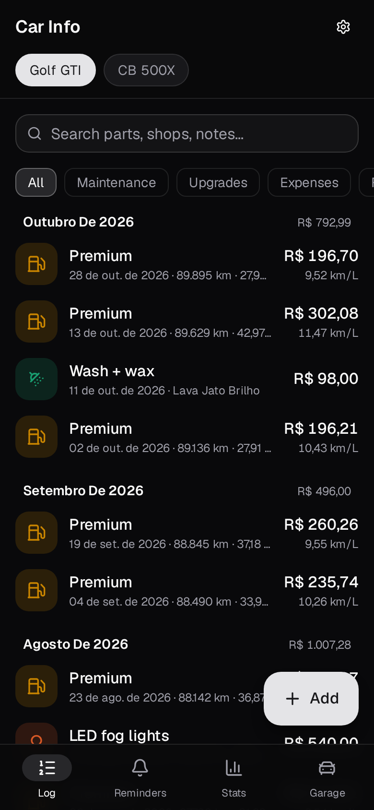
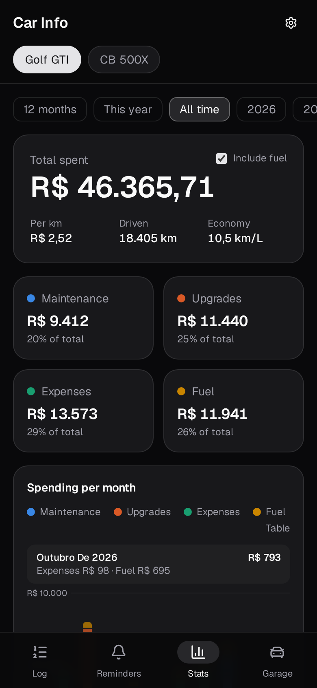
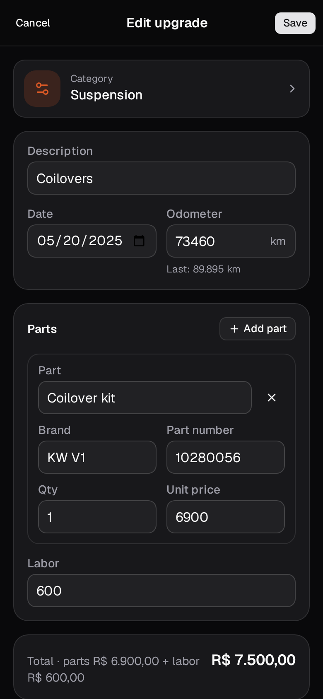
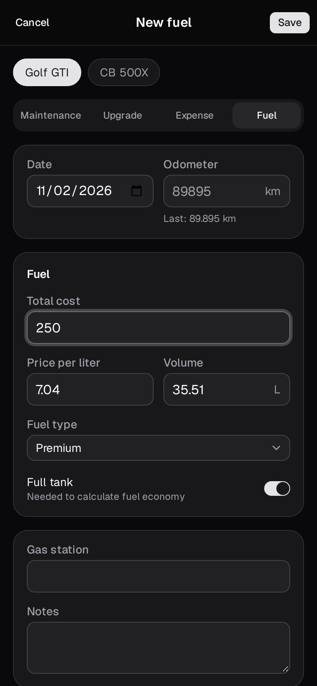
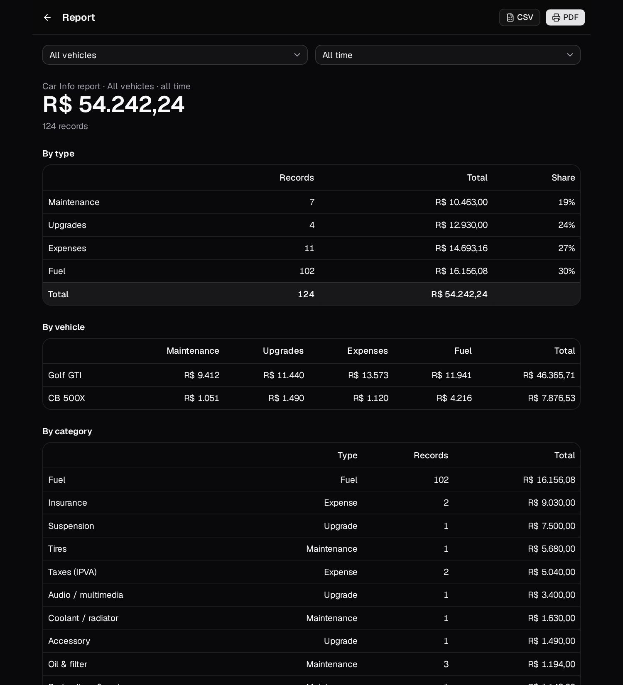

# Car Info

Self-hosted tracker for what your vehicles cost: maintenance (with every part, brand, part number and labor), upgrades, fuel, and paperwork (IPVA, insurance, fines). Dark mode, mobile first, with an Android app.

<p>
  
  
  
  
</p>

- **Log**: one timeline per vehicle, filter by kind, search across parts, shops and notes.
- **Fuel at the pump**: the Android app opens straight into the fuel form with the last price filled in, so typing the total is enough. Without a connection the fill-up is kept on the phone and synced later.
- **Receipts & documents**: attach photos or PDFs to any record (invoices, receipts) and to a vehicle (registration, insurance policy, manual). Photos are downscaled on the phone before upload.
- **Reminders**: by km and/or months. Logging a service in the same category resets it automatically.
- **Stats**: total spent, cost per km, fuel economy (full-tank method), spend per month by kind, ranking by category, parts vs labor, total cost of ownership.
- **Report**: per vehicle or all of them, per year or all time, printable to PDF, plus a CSV of every record (`;` and decimal commas in pt-BR, so Excel opens it right).
- **Import**: Car Notes Excel exports (preview first, importing twice adds nothing).
- **Backups**: daily SQLite snapshots plus a copy of every attachment on the server (kept 30 days), JSON export/restore and a database download in Settings.



## Layout

| Path | What |
| --- | --- |
| `server/` | Bun + Hono API over SQLite (`bun:sqlite`). Also serves the built web app. |
| `web/` | React + Vite + shadcn/ui (same setup as compass). Installable PWA. |
| `web/android/` | Capacitor wrapper that turns the web build into an APK. |
| `deploy/` | Dockerfile, compose file, and kustomize manifests for the homelab. |

## Develop

```sh
bun install                 # installs server + web
bun run dev:server          # API on :8080, data in server/data
bun run dev:web             # Vite on :5173, proxies /api
bun run test

# Made-up data to look around with (used for the screenshots):
DATA_DIR=/tmp/car-info-demo bun scripts/seed-demo.ts
DATA_DIR=/tmp/car-info-demo bun --cwd server src/index.ts
```

## Deploy (homelab)

CI pushes `ghcr.io/krymancer/car-info:{sha,latest}` on every push to `main`.

```sh
kubectl apply -k deploy/k8s/overlays/homelab
kubectl -n car-info create secret generic car-info-secrets --from-literal=APP_PASSWORD=...
```

- The live database and attachments sit on a node-local PVC (`car-info-data`); SQLite should not run on SMB/NFS.
- Daily snapshots and attachment copies go to `/backups`, which the overlay mounts from the NAS over NFS (`/mnt/nas/share/data/cars`, change it in `backups-nfs.yaml`). The folder must be writable by uid 1000.
- The ingress only answers the LAN and Tailscale. Without `APP_PASSWORD` the app is open to anyone on those.
- The live cluster runs a copy of these manifests from `krymancer/homelab-infra` (`k8s/apps/car-info`), where CI pins each new image digest.

Or with Docker: `APP_PASSWORD=... docker compose -f deploy/docker/compose.yml up -d --build`.

| Env | Default | |
| --- | --- | --- |
| `PORT` | `8080` | |
| `DATA_DIR` | `./data` | SQLite file location |
| `FILES_DIR` | `$DATA_DIR/files` | attachments |
| `BACKUP_DIR` | `$DATA_DIR/backups` | daily snapshots |
| `BACKUP_KEEP` | `30` | daily snapshots to keep |
| `APP_PASSWORD` | unset | shared password for the API |

## Android

Two options:

1. **APK** (recommended): download it from the [latest release](../../releases/latest), or build it with `bun run apk` → `out/car-info.apk`. On first launch, enter the server URL and password.
2. **PWA**: open the site in Chrome, then *Install app*.

Both keep the last loaded data on the device and queue new records while the server is unreachable.

The APK build needs JDK 21 and the Android SDK (`~/Android/Sdk`). Release signing reads `~/.config/car-info/keystore.env`. **Back up that folder**: Android only installs updates signed with the same key.

To have CI build signed APKs (attached to `v*` tag releases), add repo secrets:

```sh
gh secret set ANDROID_KEYSTORE_BASE64 < <(base64 -w0 ~/.config/car-info/release.jks)
gh secret set ANDROID_KEYSTORE_PASSWORD   # value from keystore.env
```
